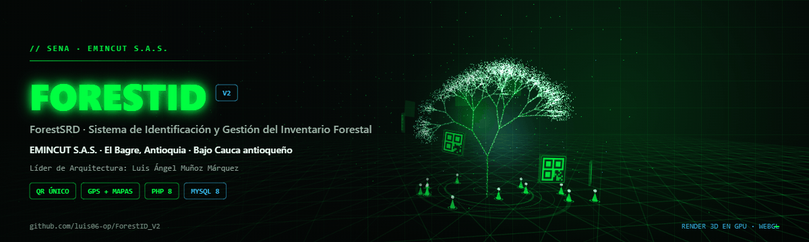
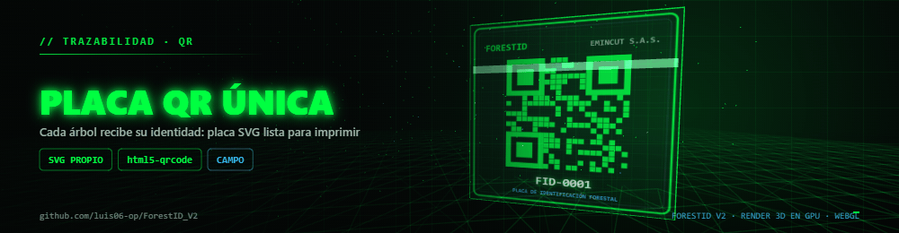
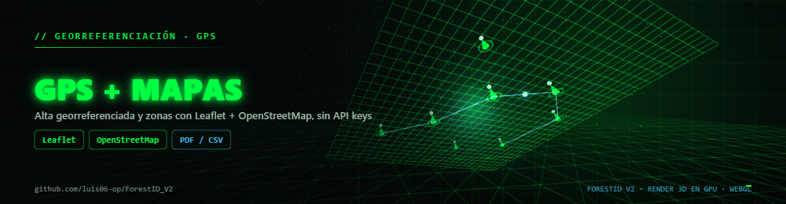
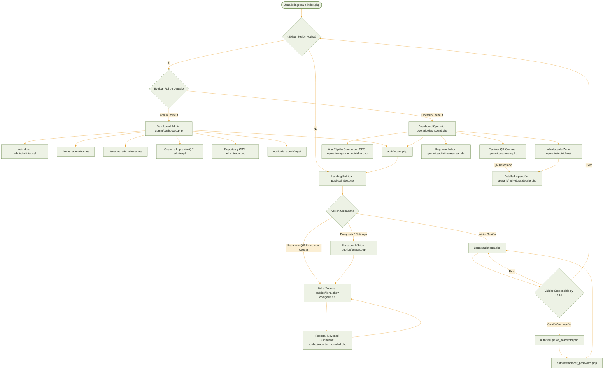
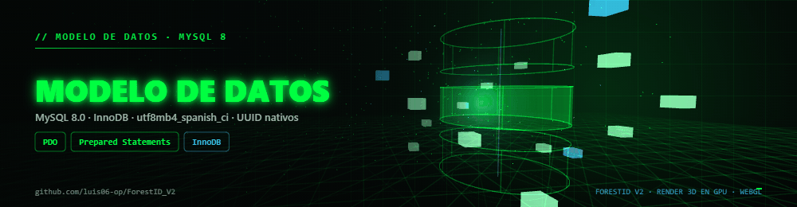
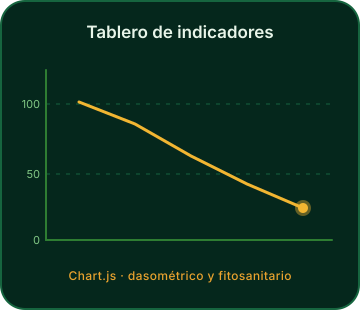

<div align="center">



# 🌲 ForestID</sub>

**Cada árbol con identidad digital** — escanea su placa QR y consulta al instante su historia,
su salud fitosanitaria y su ubicación exacta.



<br/>


<br/>


</div>

**ForestID** (ForestSRD) es una plataforma web integral para la catalogación, el monitoreo fitosanitario y la trazabilidad histórica del arbolado urbano y rural de la empresa **Emincut S.A.S.**, con sede en el municipio de **El Bagre, Antioquia** (Bajo Cauca antioqueño).

Cada individuo forestal recibe una **placa QR única**: el personal de campo la escanea con el celular para registrar salud y mantenimientos con coordenadas GPS, y cualquier ciudadano puede consultar su ficha técnica o reportar novedades **sin iniciar sesión**.

<div align="center">

| 🌳 **9 tablas** | 👥 **3 roles** | 🏷️ **QR SVG propio** | 🔒 **100 % Prepared Statements** |
| :--: | :--: | :--: | :--: |
| Esquema MySQL 8.0 con llaves **UUID** nativas | Admin · Operario · Ciudadano | Placas vectoriales listas para imprimir | Inyección SQL imposible por diseño |
| *InnoDB · utf8mb4_spanish_ci* | *Middleware de sesión por rol* | *Escáner con `html5-qrcode`* | *Bcrypt + auditoría con IP* |

</div>

---

<a id="indice"></a>
## 📌 Índice

|  |  |  |
| :--: | :--: | :--: |
| ⚡ [Instalación rápida](#instalacion) | 🌳 [Acerca del proyecto](#acerca) | ✨ [Características](#caracteristicas) |
| 🧩 [Módulos y roles](#modulos) | 🗺️ [Mapa de navegación](#flujo) | 🎨 [Diseño Amarillo Sol](#diseno) |
| 🗄️ [Modelo de datos](#datos) | 🛠️ [Stack tecnológico](#stack) | 🔐 [Seguridad](#seguridad) |
| 📁 [Estructura del proyecto](#estructura) | 📚 [Documentación](#docs) | 🎬 [Renderizado 3D](#render3d) |
| 👥 [Equipo de proyecto](#equipo) | 🏆 [Reconocimientos](#reconocimientos) | ⬆️ [Volver arriba](#indice) |

---

<a id="instalacion"></a>
## ⚡ Instalación rápida

Corre en **XAMPP** (desarrollo) o en **LAMP / LEMP** (producción), sin Node y sin servicios de pago. Las dependencias PHP (PHPMailer y el generador QR) ya están incluidas en `vendor/`; Composer solo se necesita para actualizarlas.

| # | Paso | Detalle |
| :--: | :-- | :-- |
| 1️⃣ | **Copiar el proyecto** | Llévelo a `C:\xampp\htdocs\ForestID_V2` (Windows) o `/opt/lampp/htdocs/ForestID_V2` (Linux). |
| 2️⃣ | **Arrancar servicios** | En el panel de XAMPP active **Apache** y **MySQL**. |
| 3️⃣ | **Importar la BD** | Abra `http://localhost/phpmyadmin`, cree `forestsrd_db` con collation `utf8mb4_spanish_ci` e importe [`database/forestsrd_db.sql`](database/forestsrd_db.sql) (DDL + DML con datos semilla). |
| 4️⃣ | **Ajustar conexión y URL** | Copie `config/config.local.ejemplo.php` → `config/config.local.php` y defina `DB_HOST`, `DB_NAME`, `DB_USER`, `DB_PASS`. En producción defina también `APP_URL` con el dominio real (ej. `https://forestid.emincut.com/`), porque ese valor se codifica en los QR. Ese archivo está en `.gitignore`. |
| 5️⃣ | **Permisos de Apache** | Confirme que `AllowOverride All` esté activo y que `mod_rewrite` esté habilitado; los `.htaccess` incluidos bloquean `.git`, `database/`, `docs/`, `config/`, `includes/` y `vendor/` por HTTP. |
| 6️⃣ | **Correo (opcional)** | Copie `config/mailer.ejemplo.php` → `config/mailer.php` y ponga su SMTP real. Sin ese archivo el sistema usa `mail()` de respaldo y ofrece enlaces manuales de correo / WhatsApp. *(El archivo real está en `.gitignore`: nunca sube credenciales.)* |
| 7️⃣ | **Entrar** | 👉 **`http://localhost/ForestID_V2/`** |

> **QR y dominio:** si cambia de servidor o dominio, configure `APP_URL` y entre a **Admin → Gestor QR** para regenerar las placas (individual o masivamente). Los QR semilla apuntan a `http://localhost/ForestID_V2/` y deben regenerarse en producción.

### 🔑 Credenciales de prueba (entorno local)

| Rol | Correo | Contraseña | Alcance |
| :-- | :-- | :-- | :-- |
| **AdminEmincut** | `admin@emincut.com` | `Admin123*` | Control total: usuarios, zonas, QR masivo, reportes y logs. |
| **OperarioEmincut** | `operario@emincut.com` | `Operario123*` | Escaneo QR con cámara, alta rápida con GPS y mantenimientos. |
| **UsuarioPublico** | `ciudadano@emincut.com` | `Ciudadano123*` | Portal ciudadano: ficha pública y reporte de novedades. |

> ⚠️ **Solo para entorno local.** Estas cuentas vienen del script SQL con hashes Bcrypt reales, pero sus contraseñas son públicas (están en este README). **Cámbielas o elimínelas antes de publicar el sistema en Internet.** El login ya **no** acepta credenciales en texto plano ni las autocompleta.
>
> 💡 Al crear un usuario nuevo desde el panel, el sistema **envía sus credenciales automáticamente por correo** (PHPMailer/SMTP) y ofrece el envío por **WhatsApp**.

---

<a id="acerca"></a>
## 🌳 Acerca del proyecto

ForestID nació como respuesta a una necesidad real de **Emincut S.A.S.**: dejar atrás las listas en papel y las planillas dispersas para tener un inventario vivo, georreferenciado y auditable del arbolado de El Bagre. Hoy funciona como una aplicación web modular en **PHP puro + MySQL**, pensada para correr en servidores locales XAMPP y en entornos LAMP/LEMP de producción, sin dependencias de compilación ni servicios de pago. El proyecto también acompaña el cumplimiento de la **Ley 2173 de 2021** (restauración posminerera).

|  |  |
| :-- | :-- |
| 🏢 **Cliente** | Emincut S.A.S. — «En camino con la minería responsable» |
| 📍 **Sede / cobertura** | El Bagre, Antioquia (Bajo Cauca antioqueño) |
| 🎓 **Origen** | SENA Regional Antioquia – iRed Innovacción |
| 🎯 **Objeto** | Catalogación, monitoreo fitosanitario y trazabilidad histórica del arbolado |
| 📜 **Norma** | Ley 2173 de 2021 — restauración posminerera |
| 👥 **Usuarios** | Administradores, operarios de campo y ciudadanía en general |
| 💻 **Despliegue** | XAMPP (desarrollo local) · LAMP / LEMP (producción) |

---

<a id="caracteristicas"></a>
## ✨ Características destacadas

|  |  |
| :-- | :-- |
| **🏷️ Placas QR propias**<br/>Generador vectorial SVG autónomo integrado: cada árbol obtiene su placa única, lista para imprimir y pegar en campo. | **📱 Escáner en campo**<br/>Lectura en vivo de placas con la cámara del celular o la webcam mediante `html5-qrcode`. |
| **🗺️ GPS + mapas**<br/>Alta rápida georreferenciada y visualización de zonas e individuos con Leaflet + OpenStreetMap, sin claves de API ni costos. | **🩺 Salud del arbolado**<br/>Historial inmutable de estados fitosanitarios con diagnóstico, recomendaciones y evolución en el tiempo. |
| **📊 Tableros y reportes**<br/>Indicadores dasométricos y fitosanitarios con Chart.js, más exportación de reportes a CSV / Excel. | **🌐 Portal ciudadano**<br/>Ficha técnica pública vía QR, explorador y buscador de árboles, y reporte de novedades sin iniciar sesión. |
| **🔍 Trazabilidad total**<br/>Bitácora de actividades (poda, fumigación, riego…) y auditoría de logs con IP de origen y detalles en JSON. | **🔒 Seguridad por diseño**<br/>Bcrypt, roles por sesión, middleware de autenticación y consultas 100 % con Prepared Statements. |
| **✉️ Credenciales automáticas**<br/>Al crear un usuario se envían sus accesos por correo (PHPMailer/SMTP) y por WhatsApp, con respaldo manual si no hay SMTP. | **🔔 Notificaciones**<br/>Módulo de avisos reutilizable (`includes/notificaciones.php`) con plantilla HTML institucional y control de éxito/errores. |

<div align="center">
<table>
<tr>
<td width="50%" align="center">

<sub><b>Placa QR única</b> · identidad por individuo</sub>
</td>
<td width="50%" align="center">

<sub><b>GPS + mapas</b> · alta y rutas de monitoreo</sub>
</td>
</tr>
</table>
</div>

---

<a id="modulos"></a>
## 🧩 Módulos y roles

| Módulo | Ruta | Rol | Qué puedes hacer |
| :-- | :--: | :-- | :-- |
| 🧑‍💼 **Administrador** | `/admin/` | `AdminEmincut` | Dashboard de indicadores, gestión de individuos y zonas internas de Emincut, generación e impresión masiva de placas QR, reportes con exportación, administración de usuarios y bitácora de logs. |
| 🌿 **Operario de campo** | `/operario/` | `OperarioEmincut` | Escaneo QR con la cámara, alta rápida de individuos con GPS, registro de mantenimientos y actualización del estado fitosanitario. |
| 🌐 **Portal ciudadano** | `/publico/` | Sin login | Ficha técnica pública por QR, explorador y buscador de árboles y reporte de novedades con evidencia fotográfica. |
| 🔑 **Autenticación** | `/auth/` | — | Inicio y cierre de sesión, y recuperación de contraseña mediante token criptográfico de un solo uso (válido 1 hora). |
| ✉️ **Notificaciones** | `includes/` | — | Envío de credenciales por correo y WhatsApp al crear cuentas, con plantilla HTML institucional. |

---

<a id="flujo"></a>
## 🗺️ Mapa de navegación

Todo el sistema arranca en `index.php`, que evalúa la sesión y enruta según el rol. Este es el flujo completo —del ciudadano que escanea la placa hasta el administrador que imprime QR— con las recuperaciones de contraseña y el cierre de sesión incluidos:



<sub>📖 Diagrama completo y en su contexto: <a href="docs/diagramas/diagrama_flujos.md"><code>docs/diagramas/diagrama_flujos.md</code></a> · también el <a href="docs/diagramas/diagrama_er.md">diagrama Entidad-Relación</a>.</sub>

---

<a id="diseno"></a>
## 🎨 Sistema de diseño «Amarillo Sol»

Identidad visual extraída del logo oficial de **Emincut S.A.S.** y versionada en [`assets/css/emincut.css`](assets/css/emincut.css): verdes de colina y ámbar/amarillo de sol, con tipografías `Chakra Petch` (display) y `Asap` (texto).

| Rol | Variable | Hex | Uso |
| :-- | :-- | :--: | :-- |
| 🟩 **Verde colina** | `--emi-verde` | `#5B7C3A` | Color principal de marca. |
| 🌲 **Verde casco** | `--emi-verde-oscuro` | `#35502B` | Cabeceras y superficies firmes. |
| 🌑 **Verde noche** | `--emi-verde-noche` | `#22371C` | Fondos profundos y degradados. |
| 🌿 **Verde suave** | `--emi-verde-suave` | `#EDF2E5` | Bloques e indicadores suaves. |
| ☀️ **Amarillo sol** | `--emi-amarillo` | `#F2B632` | Acentos, sol naciente y resaltados. |
| 🟡 **Ámbar** | `--emi-ambar` | `#E9A22E` | Tipografía de acento y alertas cálidas. |
| 🧈 **Ámbar suave** | `--emi-amarillo-suave` | `#FBEFD4` | Fondos cálidos de tarjetas. |
| 🦴 **Hueso** | `--emi-hueso` | `#FBFAF6` | Fondo claro cálido (no gris puro). |
| ⬛ **Tinta** | `--emi-tinta` | `#23291F` | Texto principal verde-negro. |

La atmósfera visual del login y del portal público reproduce un **sol naciente sobre las colinas del Bajo Cauca** (radiales de ámbar sobre verde), coherente con el logo institucional.

---

<a id="datos"></a>
## 🗄️ Modelo de datos

La base de datos `forestsrd_db` corre sobre **MySQL 8.0** con motor **InnoDB**, juego de caracteres `utf8mb4` (collation `utf8mb4_spanish_ci`) y **llaves primarias UUID** generadas nativamente con `DEFAULT (UUID())`.

<div align="center">



<sub><b>esquema relacional volumétrico</b> · MySQL 8.0 · InnoDB · render 3D en GPU</sub>

</div>

| Capa lógica | Tablas | Contenido |
| :-- | :-- | :-- |
| 🔐 **Acceso y seguridad** | `roles` · `usuarios` · `tokens_recuperacion` | Catálogo de perfiles, cuentas del personal de Emincut con Bcrypt y tokens temporales de 1 hora. |
| 🗺️ **Territorial** | `zonas` | Parques, campus y sectores internos de Emincut, georreferenciados. |
| 🌳 **Núcleo dendrológico** | `individuos_forestales` · `estados_fitosanitarios` | Registro maestro (placa, DAP, altura, copa, siembra, GPS, foto) e historial de salud inmutable. |
| 🕵️ **Actividad y auditoría** | `actividades_mantenimiento` · `logs_sistema` | Labores silviculturales y reportes ciudadanos, más bitácora de eventos con IP y detalles JSON. |

---

<a id="stack"></a>
## 🛠️ Stack tecnológico

| Capa | Tecnología | Detalle |
| :-- | :-- | :-- |
| ⚙️ **Backend** | **PHP 8.x** puro | Arquitectura modular sin frameworks; **100 % de consultas con Prepared Statements** de PDO. |
| 🗄️ **Base de datos** | **MySQL 8.0** / MariaDB 10.3+ | InnoDB, `utf8mb4_spanish_ci` y llaves primarias UUID nativas. |
| 🔑 **Autenticación** | `password_hash()` / `password_verify()` | Bcrypt + control de acceso por sesión y roles. |
| 🎨 **Frontend** | HTML5 semántico · **Tailwind CSS** (CDN) · JavaScript ES6+ | Interfaz responsive con **Lucide Icons** e identidad *Amarillo Sol*. |
| 🗺️ **Georreferenciación** | **Leaflet.js** + OpenStreetMap | Cartografía 100 % libre, sin APIs de pago. |
| 🏷️ **Códigos QR** | `chillerlan/php-qrcode` + `html5-qrcode` | QR estándar ISO/IEC 18004 en SVG, verificables con cualquier lector, y escaneo con cámara en vivo. |
| 📊 **Analítica** | **Chart.js** | Tableros dasométricos y fitosanitarios. |
| ✉️ **Correos** | **PHPMailer** (SMTP) | Envío de credenciales con respaldo `mail()` y enlaces manuales de WhatsApp. |

---

<a id="seguridad"></a>
## 🔐 Seguridad

- ✅ **Inyección SQL imposible:** el 100 % de las consultas usan *Prepared Statements* de PDO con paso estricto de parámetros (concatenar variables en SQL está prohibido por convención).
- ✅ **Contraseñas con Bcrypt** mediante `password_hash()` / `password_verify()` (coste 12), sin credenciales en texto plano ni rehasheos automáticos.
- ✅ **Control de acceso por roles** con el middleware `includes/auth_check.php`.
- ✅ **Tokens de recuperación** criptográficos, de un solo uso y con validez de 1 hora; el enlace se envía por correo y **nunca se muestra en pantalla** (salvo modo demo local explícito con `FORESTID_MODO_DEMO=1`).
- ✅ **Auditoría inmutable** en `logs_sistema` con estructura JSON e IP de origen.
- ✅ **Credenciales fuera de Git:** `config/mailer.php` y `config/config.local.php` están en `.gitignore`; solo se versionan las plantillas.
- ✅ **Rutas sensibles bloqueadas por HTTP:** `.git`, `database/`, `docs/`, `config/`, `includes/` y `vendor/` devuelven 404 gracias a los `.htaccess`.
- ✅ **QR verificados:** los SVG se comprobaron con `zbarimg`; codifican la URL pública de cada ficha.

---

<a id="estructura"></a>
## 📁 Estructura del proyecto

<details>
<summary>📂 <b>Haz clic para desplegar el árbol de carpetas</b></summary>

<br/>

```text
ForestID_V2/
├── index.php      # Enrutador principal (redirige según rol o al portal público)
├── config/        # Conexión PDO, constantes globales y plantilla de correo (mailer)
├── auth/          # Login, logout y recuperación de contraseña con token
├── admin/         # Panel administrativo (individuos, zonas, QR, reportes, logs, usuarios)
├── operario/      # Panel de campo (escáner QR, alta rápida con GPS, mantenimientos)
├── publico/       # Portal ciudadano (ficha vía QR, catálogo y reporte de novedades)
├── includes/      # Componentes, middlewares, helpers, generador QR y notificaciones
├── assets/        # CSS institucional, JS, imágenes, QR SVG generados y subidas
├── error/         # Páginas de error 403, 404 y 500
├── database/      # Script DDL + DML completo para MySQL 8.0
├── vendor/        # PHPMailer (envío de credenciales por SMTP)
└── docs/          # Manuales, diccionario de datos, diagramas y prompt de contexto
```

</details>

---

<a id="docs"></a>
## 📚 Documentación

Todo el conocimiento del proyecto vive en [`docs/`](docs):

[](docs/MANUAL_USUARIO.md)
[](docs/MANUAL_TECNICO.md)
[](docs/DICCIONARIO_DATOS.md)
[](docs/diagramas/diagrama_er.md)
[](docs/diagramas/diagrama_flujos.md)
[](docs/PROMPT_CONTEXTO.md)

---

<a id="render3d"></a>
## 🎬 Renderizado 3D de los banners

Los banners de este README **no son imágenes estáticas**: son escenas 3D reales construidas con **WebGL** y renderizadas con la **tarjeta gráfica** fotograma a fotograma, y después convertidas a GIF.

|  |  |
| :-- | :-- |
| 🧊 **Motor 3D** | Three.js + **WebGL** (todo el pipeline es propio, sin servicios de pago) |
| 🎮 **Tarjeta gráfica** | **AMD Radeon RX 9060 XT** — backend `ANGLE · Direct3D 11 · vs_5_0 / ps_5_0` |
| 🎞️ **Escenas** | Árbol con placas QR en órbita y pines GPS · Placa QR con línea de escaneo · Mapa con rejilla, pines y ruta de monitoreo · Base de datos volumétrica con filas orbitando |
| ✨ **Post-proceso** | Glow aditivo, luciérnagas, terreno ondulado, anillos de radar y barrido de escaneo |
| ⚡ **Rendimiento** | **~0,2–0,3 ms por fotograma en GPU**; el coste real del pipeline está en la codificación GIF (CPU + FFmpeg) |
| 📦 **Assets** | `assets/readme/*.gif` — ver [`assets/readme/README.md`](assets/readme/README.md) para el detalle técnico |

<div align="center">
<table>
<tr>
<td width="50%" align="center">

<sub><b>Analítica viva</b> · Chart.js</sub>
</td>
<td width="50%" align="center">

<sub><b>Escaneo QR</b> · del campo a la ficha</sub>
</td>
</tr>
</table>
</div>

---

<a id="equipo"></a>
## 👥 Equipo de proyecto

| Nombre | Rol en ForestID |
| :-- | :-- |
| **Luis Angel Muñoz Márquez** | 🏗️ Líder de Arquitectura |
| **Gabriel Jaime Correa Correa** | ⚙️ Desarrollador Backend |
| **Valentina Hernández Zapata** | ✅ Supervisor / Verificador de Calidad |
| **Michael Rodríguez Londoño** 💐 | 🎨 Desarrollador UI / QA *(In memoriam)* |

Todos formados en el **Centro de Formación Minero Ambiental de El Bagre** — SENA Regional Antioquia.

---

<a id="reconocimientos"></a>
## 🏆 Reconocimientos

<div align="center">

🌱 Proyecto desarrollado en el **Centro de Formación Minero Ambiental**<br/>
para la empresa **Emincut S.A.S.** — El Bagre, Antioquia 🇨🇴

<br/>

✨ En memoria de **Michael Rodríguez Londoño** (UI / QA), cuyo sello quedó en cada pantalla de ForestID.


[](#indice)

<sub>Hecho con 💚 y PHP puro en el Bajo Cauca antioqueño.</sub>

</div>
