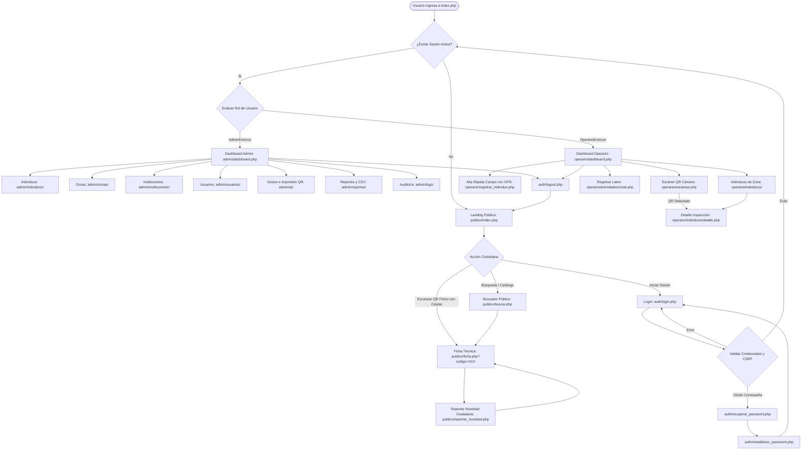

# Diagrama de Flujo de Navegación del Sistema — ForestID

Flujo integral de usuarios públicos, operarios de campo y administradores desde el punto de entrada `index.php` hasta los paneles correspondientes y la interacción con códigos QR.

